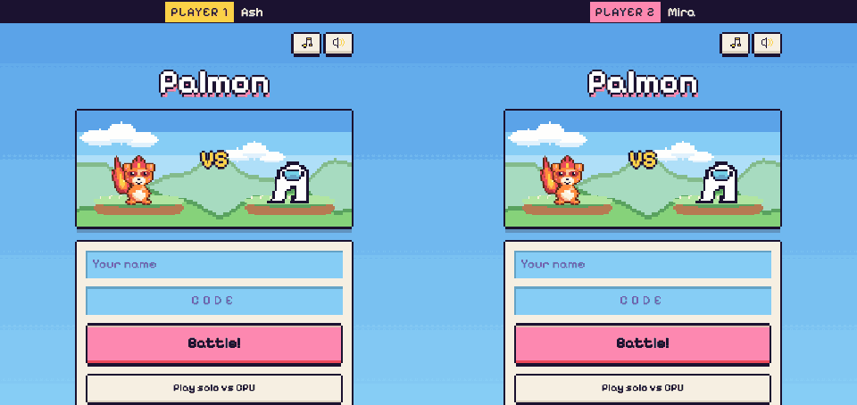
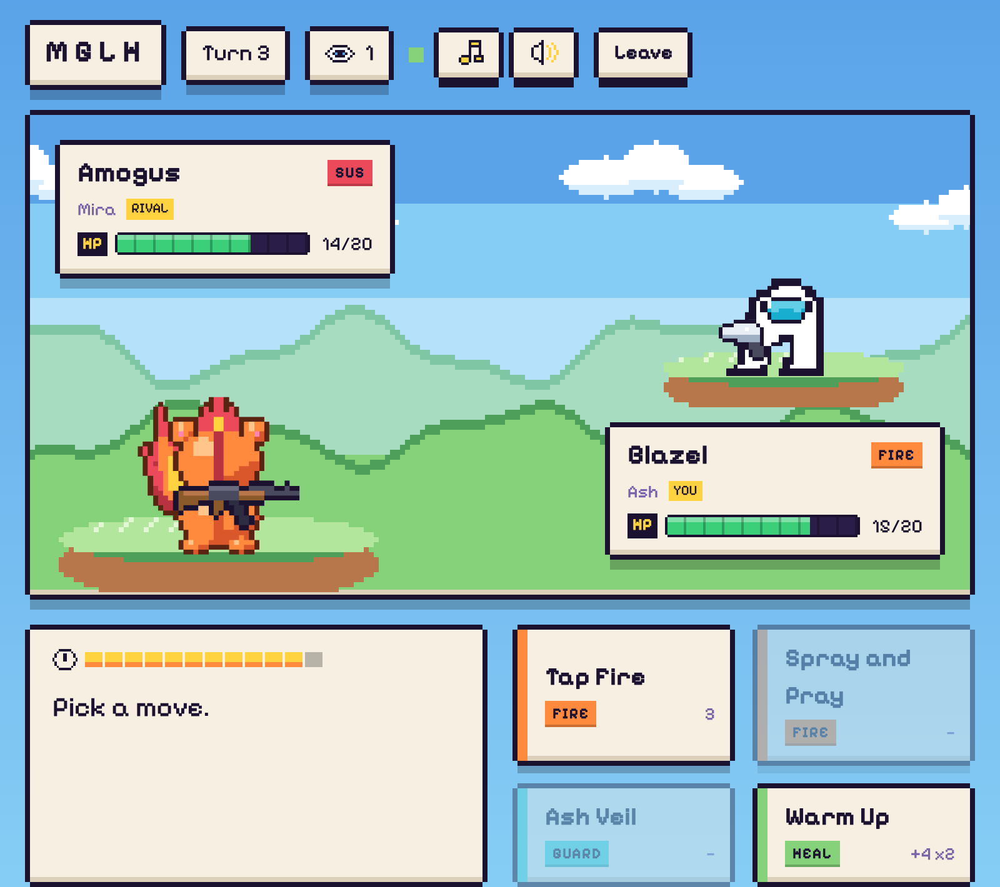
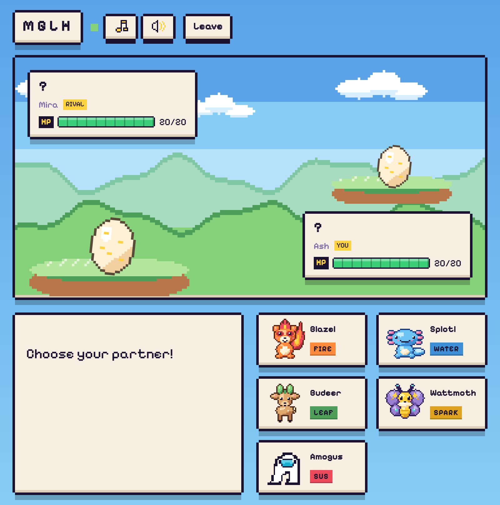

# Palmon



A pixel creature battle game, with friends by link or solo against the CPU. Each room is a Rivet Actor written with `@rivetkit/effect`, and the frontend is [Effect UI](https://ui.effect.website).

## What it shows

- **Secret hands:** `canSubscribe` lets only players get the `Hand` event, so a spectator's "Peek" is refused.
- **Turn timers:** every phase ends on the room's `schedule`, which survives a restart or a sleep.
- **Reload mid-fight:** HP, hands and the turn live in the room's SQLite, so a reload puts you back in the same turn.
- **Solo:** a CPU trainer picks on the room's `schedule` and sees only its own hand.
- **Results:** the room destroys itself, and its `onDestroy` writes the result to a `Leaderboard` actor that keeps the newest 8.

<p>
  
  
</p>

Five fighters, four moves each, and both players pick at the same time. Guns change the look and sound, never the damage. The music and sound are original, synthesized with Tone.js.

## Run

```sh
pnpm install
pnpm dev   # http://localhost:8133
```

Open it in two windows to battle, or press **Play solo**. `pnpm test` runs end-to-end tests against a real local engine.

On `localhost`, or with `?devtools` in the URL, the page shows the Effect UI devtools overlay: its timeline, state diffs and time travel.
For agents, run `pnpm dev:web` beside the running server and point the agent at the devtools MCP server, `http://127.0.0.1:4783/mcp`.

## Deploy

The `Dockerfile` builds a runner image for Rivet Cloud. Set `PUBLIC_RIVET_ENDPOINT`, `PUBLIC_RIVET_NAMESPACE` and the secret `RIVET_ADMIN_TOKEN`. The cluster sets the rest.

## Layout

```
shared/api.ts   contracts: Room and Leaderboard actors
server/         room, rules, CPU trainer, leaderboard, HTTP
web/src/        Effect UI app: model, update, commands, subscriptions, views
web/src/art/    pixel art
web/src/music/  chiptune score and player
test/           end-to-end tests
```

`rivetkit-effect-pr1800.tgz` is a prerelease of `@rivetkit/effect`. `@effect/ui` and `@effect/ui-kit` are not on npm yet: they are public-preview snapshots from [pkg.pr.new](https://pkg.pr.new/~/Effect-TS/ui), pinned to commit `87a704b` of [Effect-TS/ui](https://github.com/Effect-TS/ui).
